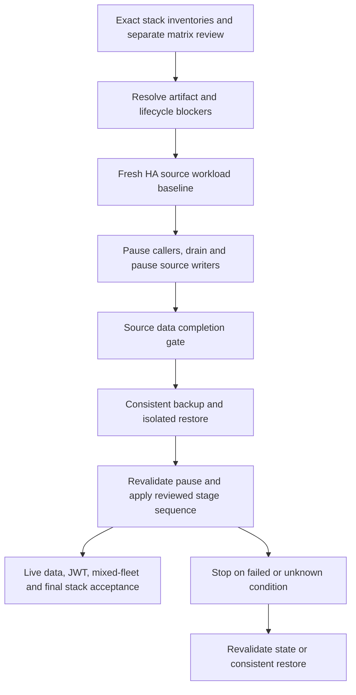

# Self-Managed stack upgrade rehearsal draft

This draft covers [issue #3558](https://github.com/dsx-ai-factory/nvcf/issues/3558).
It describes three-stack candidates, not enabled supported execution.
Resolve applicable contract blockers before each upgrade action. Source
bootstrap and preparation alone do not qualify the hop.

## Scope and version identities

| Route | Source control / compute / observability | Target control / compute / observability |
| --- | --- | --- |
| Stack 1.0.1 to 1.0.4 | 1.0.1 / 1.0.0 / 1.0.0 | 1.0.4 / 1.0.5 / 1.0.0 |
| Stack 1.0.4 to 1.1.5 | 1.0.4 / 1.0.5 / 1.0.0 | 1.1.5 / 1.1.0 / 1.1.0 |

Read each endpoint's documentation reference separately:

- [Docs 1.0.1 matrix](https://docs.nvidia.com/nvcf/1.0.1/release-notes/compatibility-matrix):
  control 1.0.1, compute 1.0.0, observability 1.0.0.
- [Docs 1.0.4 matrix](https://docs.nvidia.com/nvcf/1.0.4/release-notes/compatibility-matrix):
  control 1.0.10, compute 1.0.5, observability 1.0.0.
- [Docs 1.1.0 matrix](https://docs.nvidia.com/nvcf/1.1.0/release-notes/compatibility-matrix):
  control 1.1.5, compute 1.1.0, observability 1.1.0.

Compute Plane and Observability are selected from each corresponding matrix.
Edition numbers do not redefine the issue's control-plane endpoint numbers.
Docs 1.0.4 selects control 1.0.10, so using its peers with the issue's exact
control 1.0.4 requires explicit compatibility reconciliation. The final
1.1.5 / 1.1.0 / 1.1.0 selection matches docs 1.1.0. These final selections do
not qualify intermediate or mixed-fleet combinations. Check actual selected
chart/image bytes and configuration before adapting product-edition commands.

Read the [artifact lock](../../tools/ncp-local-cluster/upgrade-lab/transitions/artifact-lock.json),
[first contract](../../tools/ncp-local-cluster/upgrade-lab/transitions/1.0.1-to-1.0.4.json),
[second contract](../../tools/ncp-local-cluster/upgrade-lab/transitions/1.0.4-to-1.1.5.json)
and [findings](../../tools/ncp-local-cluster/upgrade-lab/transitions/README.md).
The tool validates inventory identity and action structure. It does not
evaluate the contracts' runtime preconditions or execute their actions.
The [rehearsal summary](../../tools/ncp-local-cluster/upgrade-lab/transitions/README.md#scoped-rehearsal-results)
records scoped results and remaining qualification limits. Diagnostic helper
access does not satisfy the original artifact provenance gate.

## Before the hop

1. Run the lab's [fetch and audit commands](../../tools/ncp-local-cluster/upgrade-lab/README.md).
   Compare source tags, source commits and inventory digests. Stop on unknown
   identity, checksum drift, unresolved compatibility or unavailable artifacts.
2. Obtain exact selected chart packages and images. Save package hashes and
   runtime platform digests. Compare effective values with the inventory;
   source defaults do not prove packaged defaults. Run artifact probes from
   the intended environment. Manifest inspection does not prove node pulls.
3. Review the OpenBao lifecycle and migration boundaries below. Do not
   substitute a newer target or silently borrow a later release's bridge.
4. Three-way merge source defaults, source site values and target defaults.
   Retain secrets without publishing them. Render each selected stage and
   retain a private diff and configuration digest. Record exact Helm and
   Helmfile versions. The audit tool does not check installed tool versions.
5. Reject changes to replicas, Cassandra RF/DC mappings, NATS replication,
   storage, placement, registrations, workload IDs or credentials. Retain
   both existing compute clusters and their registration files. Migrate their
   selected releases without registering replacement clusters.
6. Create a fresh isolated HA baseline per route using three Cassandra,
   OpenBao and NATS members. Keep explicit contexts, unique ports, configs,
   credentials and private artifact directories. Follow repository cleanup
   rules. Do not change the default Kubernetes context.
7. Save HTTP/gRPC invocation, secret injection, function/task IDs, JWT mounts,
   catalog SHAs, OpenBao cluster identity and durable-data checksums. Verify
   original and newly created workloads on both source compute clusters.
   Use separate checkpoint client configuration and state for new workloads.
   Refresh an expired admin token there with `nvcf-cli refresh`; retain the
   original client and keys for preservation checks. An invocation key need
   not have function creation scope.
8. Pause callers, drain pending invocations and wait for native task completion.
   Pause affected source writers, then complete the source data prerequisite
   checks below. Keep that pause through the consistent backup. Do not delete
   or cancel workloads to obtain an empty queue.
9. Back up Cassandra schema/data, NATS streams/consumers/configuration,
   OpenBao Raft/unseal material, Kubernetes configuration and Helm revisions.
   Demonstrate a consistent restore in isolated storage before the hop.
   The candidate recovery profile requires all memory streams and consumers
   drained. Preserve names/configurations and record native sequence/counter
   resets; nonempty or in-flight recovery is unsupported. Helm rollback is not
   data restore.
   See [recovery prerequisites](../../tools/ncp-local-cluster/upgrade-lab/transitions/recovery-prerequisites.md).
   The selected NATS server rejects native memory-stream snapshots. A volume
   archive or an OpenBao-only restore cannot satisfy the consistent restore gate.

An earlier installation-history backfill must have explicit completion
evidence. A source version label does not prove it. Do not reuse historical
Cassandra helpers whose archive layout and topology assumptions differ.

## During the hop

The following manual sequence has scoped laboratory rehearsal evidence.
Revalidate the applicable artifact, data, JWT and compatibility gates for each
run. These results do not qualify a supported execution workflow.

| Route | Candidate action order after inventory, baseline and restore gates |
| --- | --- |
| Stack 1.0.1 to 1.0.4 | After pause, source data checks and verified recovery: update compute clusters individually from 1.0.0 to 1.0.5 with mixed-fleet acceptance; reviewed dependency/OpenBao/core stages; final acceptance. Observability remains 1.0.0. |
| Stack 1.0.4 to 1.1.5 | After pause, source data checks and verified recovery: reviewed dependency/OpenBao/core stages; acceptance with compute 1.0.5; update compute clusters individually to 1.1.0 with mixed-fleet acceptance; update observability from 1.0.0 to 1.1.0; final acceptance. |

| Action | Owner | Required checkpoint and recovery boundary |
| --- | --- | --- |
| Pause and drain before backup | Operator | Record caller and affected-writer pause. Drain each affected function/version and task without purge, cancellation or deletion. Keep the pause through data validation and backup. Resume source callers only after source health checks if abandoning before a data boundary. |
| Compute clusters | Compute owner | Verify selected package prerequisites and admission policies. Preserve registrations, credentials and topology. Keep one source and one target cluster after the first update; original/new invocations, tasks and secret injection must pass on both before continuing. |
| Dependency stage | Operator and migration owners | Review selected chart hooks and OpenBao/JWT ordering before NATS or other dependency changes. Verify Cassandra ledgers, schema/data and NATS streams/consumers before new consumers start. Unknown outcomes stop the hop. |
| OpenBao stage | OpenBao owner | Preserve plugin bytes/catalog SHA, mounts, cluster identity and credentials. Verify runtime digests, quorum, old/new JWT canaries and injection. Resolve catalog-refresh versus member-rotation ordering before applying. |
| Core and enabled control observability stages | Operator | Apply only after applicable data/JWT postconditions pass. Preserve workload identities and HA topology. Verify behavior with the compute version at this route's current checkpoint. |
| Independent observability stack | Observability owner | On the second hop, update only after core/compute acceptance. Preserve storage and routing/scrape configuration; verify monitoring, logs and traces for the final combination. |
| Acceptance and resume | Operator | Check original/new function/task behavior on both compute clusters, identity/data preservation, receipts and measured availability. Resume callers only after current matching evidence passes. |

Each contract records action dependencies, preconditions, postconditions,
owner, evidence, timeout and recovery. Preconditions are operator checks,
not executable predicates in the lab. Stage readiness, a receipt or a Job's
Complete condition alone does not prove migration or functional completion.

## Route-specific migration checks

Review [runtime prerequisites](../../tools/ncp-local-cluster/upgrade-lab/transitions/runtime-prerequisites.md)
for workload-created image gaps, callback routing, native task completion and
intermediate Observability assembly. The original stack 1.0.1 inventory omits
its effective legacy NVCT helper images. Alternate repository access does
not establish original artifact identity.

Both routes require the source instance lookup consistency gate in
[service data prerequisites](../../tools/ncp-local-cluster/upgrade-lab/transitions/service-migrations.md)
before backup. SIS 0.7.6 includes a disabled-by-default backfill task that the
selected target 0.8.5 image omits. Complete `MIGRATE` when required and then
`VALIDATE` at the source; require zero missing live requests, mismatches and
failures. Stack 1.0.1's SIS 0.7.2 needs a direct source row/request comparison
because it has no such task. Preserve the verified data epoch through backup.
These checks are separate from Cassandra schema migrations and target
postconditions.
Also require independent non-null IDs for every required target lookup.
Native `VALIDATE` can treat two null values as equal. For partial `MIGRATE`
runs, use the documented null-only rerun rules before repeating validation
and creating the consistent backup.

| Transition | Required comparison and checks |
| --- | --- |
| Cassandra 0.17.6 to 0.17.7 | Actual migration files are identical and match both source commits. Build/runtime-library changes and clean live ledgers, source RF/DC and original records still need qualification. |
| Cassandra 0.17.7 to 0.19.4 | Verify Event Ledger migration 04 adds account/function columns to both v3 tables. Verify SIS migration 11 adds creation-bucket columns and migration 12 adds creation-day indexes. Preserve existing records and ledgers. |
| OpenBao 0.19.5 to 0.19.9 | Downloaded packages and hook renders confirm stack 1.0.4 overrides chart 0.32.7's default to 0.19.9. The server image remains unchanged. Verify live migration and JWT postconditions. |
| OpenBao 0.19.9 to 0.23.1 | Compare target chart 0.36.1 and server image 2.6.3-nv-1.3.7. Prove preservation of old catalog/binary/mount identities, migration postconditions and JWT/injection behavior after failover. |

Cassandra 0.19.4 changes historical init scripts and adds explicit upgrade
migrations. Do not replay init scripts to advance a live ledger. Event Ledger
migration 04 specifies no backfill; existing rows retain null new fields.
The [artifact provenance](../../tools/ncp-local-cluster/upgrade-lab/transitions/artifact-provenance.json)
records actual migration image files matching their source commits.

The selected OpenBao catalog-refresh hook runs before migrations. The selected
linux/amd64 server images contain byte-identical JWT plugins; the suspected
plugin SHA mismatch does not apply to those platform digests. Check the live
catalog and pod file hashes before member rotation. Qualify the server change,
Raft failover, retained issuer/key/mount identities and JWT behavior separately.
Do not rewrite catalog hashes as a workaround or import a later versioned-plugin
bridge procedure. Do not initialize a replacement cluster during the hop.

Compute Plane 1.0.5 to 1.1.0 selects the optional Dynamo operator's NATS config
reloader backward from 0.25.0 to 0.24.0. This inventory finding is a conditional
check, not an unconditional route blocker. Record effective source/target
`addons.dynamoOperator.enabled` values and rendered Dynamo/NATS manifests:

- If Dynamo is disabled at both endpoints and the reloader is absent from
  both renders, retain the inventory finding without blocking this profile.
- If the actual renders show the reloader downgrade, compare chart/image
  bytes and fix retention, then verify configuration reload before the affected
  compute action. A lower version alone does not prove runtime failure.
- If applicability is unknown, resolve values and renders before that action.
  Disabled defaults and optional inventory status do not prove absence. Do not
  treat unexpected feature removal as a waiver for workload preservation.

The lab reports these conditional rules without evaluating applicability.
Preserve the selected stack versions while gathering the required evidence.

## Native commands for the scoped laboratory sequence

These commands identify native stage boundaries. They do not perform the
contract's checks, capture a backup or implement resume. Execute a stage only
after its preconditions pass. Published execution remains disabled; an
explicitly authorized diagnostic profile does not resolve original artifact
provenance.

Use the locked source exports, reviewed site overlays and explicit contexts.
`CONTROL_STAGE_DIR` and `COMPUTE_STAGE_DIR` refer to the intermediate workspace
with target control/compute sources and unchanged source Observability 1.0.0.
`FINAL_OBSERVABILITY_DIR` refers to the independently locked target source.
Keep `HELMFILE_ENV`, registry authentication, chart CA trust, private caches and
retained registration paths configured for this run. Do not change the default
Kubernetes context or edit an immutable export between stages.

For each compute action, select that existing cluster's kubeconfig, context,
name and NCA ID. `RETAINED_REGISTRATION_DIR` contains its original registration
material in the layout required by the selected native files:

```bash
cd "$COMPUTE_STAGE_DIR"
CLUSTER_NAME="$EXISTING_CLUSTER_NAME" NCA_ID="$EXISTING_NCA_ID" \
  OUTPUT_DIR="$RETAINED_REGISTRATION_DIR" \
  helmfile --file helmfile.d --environment default \
  --kubeconfig "$COMPUTE_KUBECONFIG" --kube-context "$COMPUTE_CONTEXT" sync
```

Apply compute-one, verify both clusters at the mixed state, stop at the
checkpoint and revalidate before compute-two. Check the installed target
chart, original backend UID, registration hashes and actual runtime images.
For the first route these compute actions precede the control stages. For the
second route they follow control acceptance with both original compute planes.
An unexpected registration attempt blocks the action.

Before dependencies, revalidate the source, pause callers, drain native work
and pause the recorded source application writers and both compute controllers.
Preserve their original replica counts. Require the final data epoch and native
drained-memory checks; keep writers paused through dependency migrations and
OpenBao member rotation. Never scale Cassandra, OpenBao or NATS to zero for
this upgrade sequence.

```bash
cd "$CONTROL_STAGE_DIR"
helmfile --file helmfile.d/01-dependencies.yaml.gotmpl --environment default \
  --kubeconfig "$CONTROL_KUBECONFIG" --kube-context "$CONTROL_CONTEXT" sync
```

Before core, verify current migration Job UID/image and clean ledgers, original
records and RF/DC, applicable columns/indexes, and complete NATS configurations.
For the second route, query the new creation-bucket indexes on all three
Cassandra members. Check native NATS UID/GID, storage writability and stream
replication. A completed Helm command does not replace these checks.

Read the OpenBao StatefulSet update revision and current Raft leader. Under
`OnDelete`, replace only old-revision members, one follower at a time and the
leader last. Before advancing, require each replacement's new Pod UID,
expected revision, selected image, readiness and the same cluster identity.
Then compare all original mount/auth identities, JWT public keys and catalog
hashes. Do not repeat completed rotations blindly after interruption.

For the first route, order the selected target ingress before the remaining
core consumers. Source gateway-routes 1.18.2 rejects an update of the existing
admin issuer HTTPRoute because it shares the reserved API Keys hostname.
Target 1.18.3 permits the legitimate more-specific path while continuing to
reject a competing root match. A whole-core sync can otherwise fail at the
admin proxy before reaching the ingress release that fixes the policy.

This scoped subset requires unchanged source/target native Gateway and
HTTPRoute specifications, matching existing backend Service references/ports
and the existing caller pause. Backend Pods can remain quiesced while this
routing/admission configuration is applied. Verify these conditions before
using the selector. Do not disable admission or include other consumers
implicitly:

```bash
helmfile --file helmfile.d/02-core.yaml.gotmpl --environment default \
  --kubeconfig "$CONTROL_KUBECONFIG" --kube-context "$CONTROL_CONTEXT" \
  --selector name=ingress sync --skip-needs
```

Verify the installed target chart and all original route UIDs/specifications.
Use server-side dry runs to prove that the specific admin path update is
accepted and a conflicting root-path route is still denied. A denial for an
unrelated schema or permission error does not prove the hostname policy.
This is a reviewed laboratory substep of the core action, not a generic
selector-based upgrade entry point. Retain a failed whole-core attempt and
revalidate partial state before retrying; do not replay dependency migrations.

The first route uses the released target SIS task in read-only `VALIDATE`
mode. Save this extra render separately from the immutable preparation:

```bash
helmfile --file helmfile.d/02-core.yaml.gotmpl --environment default \
  --kubeconfig "$CONTROL_KUBECONFIG" --kube-context "$CONTROL_CONTEXT" \
  --state-values-set sis.env.ICMS_INSTANCE_LOOKUP_BACKFILL_TASK_MODE=VALIDATE sync
```

The second route instead applies the unmodified native core stage after its
source SIS prerequisite has passed:

```bash
helmfile --file helmfile.d/02-core.yaml.gotmpl --environment default \
  --kubeconfig "$CONTROL_KUBECONFIG" --kube-context "$CONTROL_CONTEXT" sync
```

Complete the native control Observability stage with source Observability
still selected. Resume both compute controllers at their captured counts:

```bash
helmfile --file helmfile.d/03-observability.yaml.gotmpl --environment default \
  --kubeconfig "$CONTROL_KUBECONFIG" --kube-context "$CONTROL_CONTEXT" sync
```

Require old/new HTTP, gRPC, secret and native task acceptance. Retain the
original credentials and verify newly issued function and task keys in a
separate client. Check the unchanged pre-upgrade JWT without refreshing it.
For the first route, match the final native SIS `VALIDATE` summary to the
current lookup cohort. For the second route, accept the new control plane
with old compute before starting compute-one.

Only the second route updates the standalone Observability stack. After both
compute updates and their acceptance, apply the final source with the control
profile, then repeat with `compute` for each retained compute context:

```bash
cd "$FINAL_OBSERVABILITY_DIR"
helmfile --file helmfile.d --environment default \
  --kubeconfig "$CONTROL_KUBECONFIG" --kube-context "$CONTROL_CONTEXT" \
  --state-values-set observability.profile=control sync

CLUSTER_NAME="$EXISTING_CLUSTER_NAME" NCA_ID="$EXISTING_NCA_ID" \
  OUTPUT_DIR="$RETAINED_REGISTRATION_DIR" \
  helmfile --file helmfile.d --environment default \
  --kubeconfig "$COMPUTE_KUBECONFIG" --kube-context "$COMPUTE_CONTEXT" \
  --state-values-set observability.profile=compute sync
```

Verify collector receive/export counters, PromQL results and original PVC
identities/specifications. Complete final workload and data acceptance before
the caller-resume checkpoint. Apply the native receipt stage last among
release stages, and record its contents separately from locked release
identity; the selected exports contain a `VERSION` value that differs from
their stack tag. A receipt does not establish route completion.

```bash
cd "$CONTROL_STAGE_DIR"
helmfile --file helmfile.d/04-upgrade-receipt.yaml.gotmpl --environment default \
  --kubeconfig "$CONTROL_KUBECONFIG" --kube-context "$CONTROL_CONTEXT" sync
```

## Recovery, measurement and unsupported scope

Interrupt separately at dependency/migration, OpenBao, core, first-compute
update and observability boundaries.
Record partial state. Revalidate live postconditions before continuing and
never blindly replay an unknown migration outcome. Bind evidence to Job UID,
image digest, run identity and applicable schema. Job replacement or database
restore invalidates old completion evidence until the live checks pass again.
After an irreversible data boundary, use the tested consistent restore and
verify restored data, credentials, identities and invocation.

Measure per-action invocation success/outage intervals, caller-paused
intervals, total duration, hands-on time, commands, file edits, decisions and
recovery interventions. There is no universal maintenance-window requirement
or zero-downtime promise.
Use the [measurement procedure](../../tools/ncp-local-cluster/upgrade-lab/transitions/manual-measurement.md)
to freeze equivalent inputs, capture active work separately from waiting and
report unmeasured values without inventing a manual baseline.

Single-member installations, HA conversion, multi-DC Cassandra, Argo CD,
automatic multi-hop, physical GPU and cross-host qualification are outside
this rehearsal. Peer versions outside the recorded matrices require separate
selection. The listed mixed-fleet candidates still require live qualification.



The [rehearsal summary](../../tools/ncp-local-cluster/upgrade-lab/transitions/README.md#scoped-rehearsal-results)
covers source-cohort restore, both compute updates, mixed-fleet acceptance,
an action-boundary resume, final workloads, JWTs and member replacements.
These results cover only the recorded laboratory profile. Original helper
identity remains unverified for the first source. An earlier restore does not
establish that a later fresh snapshot was restored, or that failure recovery
across a migration data boundary passed. Both routes remain unqualified.
