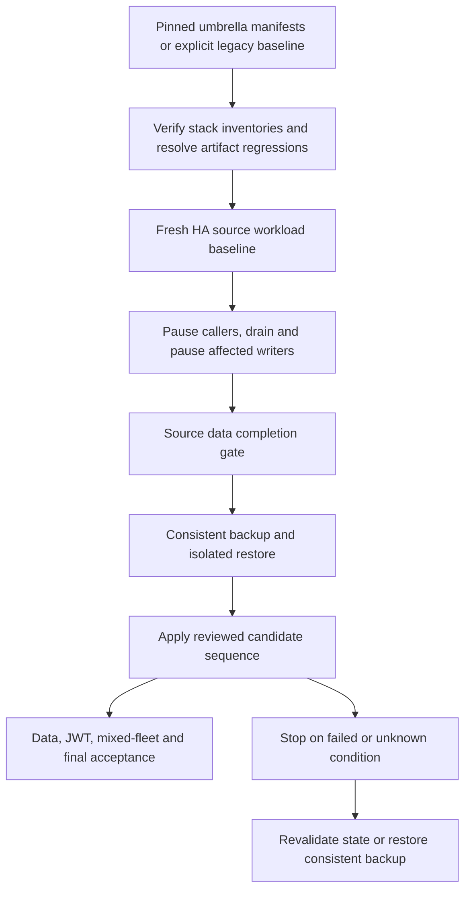

# Umbrella upgrade rehearsal draft

This draft covers [issue #3558](https://github.com/dsx-ai-factory/nvcf/issues/3558).
Both candidates remain unqualified. Supported execution remains disabled.
The lab compares artifacts and prepares renders. Operators must review and qualify each actual deployment profile.

## Scope and version identities

| Route | Source control / compute / observability | Target control / compute / observability |
| --- | --- | --- |
| Legacy NVCF 1.0.1 to umbrella 1.0.4 | 1.0.1 / 1.0.0 / 1.0.0 | 1.0.10 / 1.0.5 / 1.0.0 |
| Umbrella 1.0.4 to umbrella 1.1.0 | 1.0.10 / 1.0.5 / 1.0.0 | 1.1.5 / 1.1.0 / 1.1.0 |

Use umbrella versions for route endpoints and documentation indexing.
Resolve each endpoint through its pinned released manifest.
The first source is a legacy baseline without an umbrella manifest.
Its frozen documentation matrix selects its three stacks.
Do not create a synthetic released manifest for that baseline.
Do not infer component versions from an umbrella number.

Read the [artifact lock](../../tools/ncp-local-cluster/upgrade-lab/transitions/artifact-lock.json),
[first contract](../../tools/ncp-local-cluster/upgrade-lab/transitions/umbrella-1.0.1-to-1.0.4.json)
and [second contract](../../tools/ncp-local-cluster/upgrade-lab/transitions/umbrella-1.0.4-to-1.1.0.json).
The [current findings](../../tools/ncp-local-cluster/upgrade-lab/transitions/README.md) identify artifact regressions and remaining checks.
Final endpoint selections do not qualify intermediate or mixed-fleet states.

## Before the hop

1. Run the lab's [fetch and audit commands](../../tools/ncp-local-cluster/upgrade-lab/README.md).
   Verify manifest commit/digest and each selected stack tag, commit and original inventory digest.
   Stop on changed identities, unavailable artifacts or unresolved compatibility.
2. Obtain selected chart packages and images.
   Record package hashes, platform digests and effective helper references.
   Compare packaged defaults, site values and rendered references.
   Verify artifact access from the intended environment. Metadata access does not prove node pulls.
3. Review actual migration files, service tasks and OpenBao hooks.
   Determine bridge requirements from the selected artifacts.
   Do not borrow a later procedure without an explicit artifact and lifecycle review.
4. Merge source defaults, source site values and target defaults.
   Preserve secrets, original registrations, credentials, workload IDs and topology.
   Preserve replicas, Cassandra RF/DC mappings, NATS replication, storage and placement.
   Record tool versions, configuration digests and private render differences.
5. Follow repository safety rules before creating a fresh isolated HA baseline.
   Use explicit contexts, unique ports, private configuration and new artifact directories.
   Do not change the default Kubernetes context.
6. Retain two existing compute clusters and their original registration files.
   Record original/new HTTP and gRPC invocations, tasks, secret injection, JWTs and durable data.
   Record source quorum, catalog/plugin hashes, mount IDs and cluster identities.
7. Pause callers and drain pending invocations and tasks through their native lifecycles.
   Pause affected source writers for the final data checks.
   Do not purge queues, cancel tasks or delete workloads to satisfy the drain.
8. Complete the [service data prerequisites](../../tools/ncp-local-cluster/upgrade-lab/transitions/service-migrations.md).
   Require independent non-null lookup IDs, matching authoritative requests and complete scan counters.
   Preserve the paused data epoch through backup.
9. Create a consistent Cassandra, NATS, OpenBao and Kubernetes backup.
   Demonstrate isolated full-cohort restore before the hop.
   The candidate [recovery profile](../../tools/ncp-local-cluster/upgrade-lab/transitions/recovery-prerequisites.md) requires drained memory streams.
   Preserve stream/consumer configurations and record native sequence/cursor resets.
   Nonempty or in-flight memory recovery remains unsupported. Helm rollback does not restore data.

## Candidate action order

The following sequence is a candidate for new review and rehearsal.
Earlier stack-only rehearsal results do not establish this sequence for stack 1.0.10.
Recheck hooks, admission policies, migrations and intermediate combinations before each action.

| Route | Candidate sequence after source data and restore gates |
| --- | --- |
| Legacy 1.0.1 to umbrella 1.0.4 | Update retained compute clusters individually from 1.0.0 to 1.0.5. Check mixed-fleet behavior. Apply reviewed dependency, OpenBao and core stages. Keep Observability 1.0.0. Complete acceptance. |
| Umbrella 1.0.4 to 1.1.0 | Apply reviewed dependency, OpenBao and core stages. Check target control with compute 1.0.5. Update compute clusters individually to 1.1.0. Check mixed-fleet behavior. Update Observability last. Complete acceptance. |

Each contract records dependencies, owners, preconditions, postconditions, evidence, timeouts and recovery boundaries.
These fields describe operator checks. The lab does not execute their predicates or actions.
A Ready Pod, completed Job or release receipt alone does not establish success.

| Action | Required boundary |
| --- | --- |
| Dependencies | Verify actual migration files, clean ledgers, preserved rows and RF/DC. Check NATS data formats, storage, stream/consumer configuration and retained fixes. Stop on an unknown result. |
| OpenBao | Review plugin bridge and catalog-refresh ordering. Preserve Raft identity, mounts, credentials and JWT behavior. Rotate members only after matching current evidence passes. |
| Core | Verify data and JWT postconditions before consumers start. Recheck ingress admission ordering against actual selected packages. Preserve route and workload identities. |
| Compute | Keep original cluster IDs and registrations. After compute-one, verify original/new invocations, tasks and secret injection on both versions. Stop before compute-two on failure. |
| Observability | Retain source Observability during earlier actions. Apply target Observability only after core/compute acceptance. Verify storage, routing, monitoring, logs and traces on all retained clusters. |
| Acceptance | Verify exact final stack selections, original/new workloads, data, credentials and topology. Resume callers only after current matching evidence passes. |

Use immutable source exports and explicit kubeconfig/context arguments for each native Helmfile stage.
Keep intermediate source Observability directories separate from the final target assembly.
Do not apply a final sibling directory early or edit an exported release to make a stage pass.
The [historical native commands](https://github.com/dsx-ai-factory/nvcf/blob/aa1270cdbe356845d9d873d9424231b17be84c5b/docs/dev/upgrade-transitions.md#native-commands-for-the-scoped-laboratory-sequence)
document the previous stack-only profile. Revalidate them before using them with either current candidate.

## Artifact and migration review

The second route contains 12 backward inventory selections, including optional entries.
Determine applicability from effective values and rendered manifests.
Applicable regressions require artifact compatibility, retained-fix and runtime evidence before the affected action.
Unknown applicability also blocks that action.

- Compare Cassandra migration images 0.17.6, 0.17.8 and 0.19.4.
  Review historical init files separately from explicit upgrades. Do not replay init SQL against a live ledger.
- Verify SIS task availability in actual 0.7.2, 0.7.7 and 0.8.5 images.
  Complete required source repairs before backup. Preserve null-only partial-repair safeguards.
- Compare OpenBao server 2.6.2-nv-1.3.4, 2.6.3-nv-1.3.9 and 2.6.3-nv-1.3.7.
  Verify selected migration helpers, plugin bytes, catalog entries, mounts, Raft failover and old/new JWTs.
  Earlier plugin equality checks omit 2.6.3-nv-1.3.9.
- Review the NATS server 2.14.9 to 2.14.6 and reloader 0.25.0 to 0.24.0 regressions.
  Check storage formats, stream/consumer semantics, configuration reload and recovery.
- Review cert-manager chart 0.2.0 to 0.1.0 and image v1.20.5 to v1.20.2 regressions.
  Check CRDs, webhooks, certificates and retained fixes.
- Review removed migration consumers, the UI migration helper and receipt helper.
- Apply the separate optional Dynamo reloader rule from the second contract.
  Disabled defaults do not establish absence. Require values and renders before any applicability decision.

Read the [runtime prerequisites](../../tools/ncp-local-cluster/upgrade-lab/transitions/runtime-prerequisites.md)
for historical helper, callback, task-completion and admission findings.
Those observations remain useful review inputs. They do not establish behavior for stack 1.0.10.
Do not silently change released manifests to remove an artifact regression.

## Recovery and measurement

Test interruptions separately at dependency/migration, OpenBao, core, compute-one and Observability boundaries.
Record partial state and revalidate current postconditions before continuation.
Never replay an unknown migration result.
Bind evidence to the current contract, lock, run, artifact digests, Job/Pod identities and data epoch.
A changed contract, restore or replaced Job invalidates earlier completion evidence until checks pass again.
After an irreversible data boundary, restore the tested consistent backup and verify original data and workloads.

Use the [measurement procedure](../../tools/ncp-local-cluster/upgrade-lab/transitions/manual-measurement.md).
Measure invocation success/outages, caller pauses, duration, hands-on time, commands, edits, decisions and recovery interventions.
Compare equivalent inputs with a measured manual baseline. Report unmeasured values explicitly.
There is no universal maintenance-window target or zero-downtime promise.

Single-member installations, HA conversion, multi-DC Cassandra, Argo CD, automatic multi-hop and physical GPU qualification remain outside this rehearsal.
Cross-host and stateless callback HA need separate qualification.

## Historical evidence

The [previous rehearsal](https://github.com/dsx-ai-factory/nvcf/blob/aa1270cdbe356845d9d873d9424231b17be84c5b/tools/ncp-local-cluster/upgrade-lab/transitions/README.md#scoped-rehearsal-results)
used control stacks 1.0.1 to 1.0.4 and 1.0.4 to 1.1.5.
Its artifact inspections, restore checks and workload results retain their original identities.
They do not qualify these umbrella routes, which select control stack 1.0.10.
New live upgrade, HA, mixed-fleet, recovery and measurement evidence remains required.
